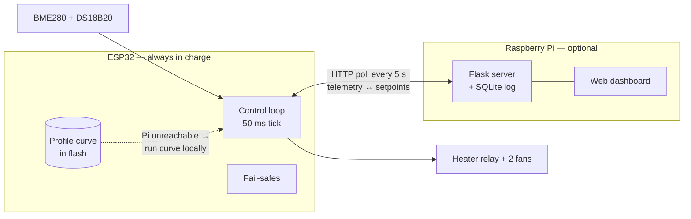

# Koji Fermenter — ESP32 temperature & humidity controller

A DIY fermentation chamber controller for **Koji** (*Aspergillus oryzae*), miso, soy sauce
or garum: an **ESP32** running MicroPython holds the substrate at a target temperature and
humidity for days, and an optional **Raspberry Pi** adds a web dashboard with charts and a
multi-step profile editor.

The controller is designed so the ESP32 stays in charge: it runs the whole schedule on its
own, keeps every safety function local, and survives a Raspberry Pi crash or a full power
cut without losing the run. The dashboard is a convenience layer, never a dependency.

*(The dashboard answers to the name **FermentiMcFermentiFace**.)*

## Features

- **Target-temperature control** with a latching chamber overshoot brake — bounded overshoot
  without any PID tuning (see [How the control works](#how-the-control-works)).
- **Two-sensor design**: a DS18B20 measures the substrate core, a BME280 the chamber air.
- **Humidity control** and **idle ventilation** (the mould needs oxygen) via two PWM fans.
- **Local 1602 LCD menu** with rotary encoder — fully usable without any network.
- **Web dashboard** (Raspberry Pi): live charts, multi-step profile editor, named profile
  library, CSV export, calendar export.
- **Autonomous profiles**: the curve + start time live in the ESP32's flash. If the Pi goes
  away, the ESP32 keeps running the schedule from its NTP-synced clock and resumes at the
  correct step after a reboot or power loss.
- **Fail-safes, always local**: chamber over-temperature cutoff, sensor-fault detection,
  sensor spike filtering, relay anti-short-cycle, optional hardware watchdog.

## How the control works

Heating is driven by one **target** plus **three deltas**, all on measurable values:

| Parameter  | Sensor  | Meaning                                                              |
|------------|---------|----------------------------------------------------------------------|
| `target`   | core    | The substrate temperature you want.                                  |
| `dt_lower` | core    | Heat while `core ≤ target − dt_lower`; stop at `target`.              |
| `dt_floor` | chamber | Also heat if the air drops below `target − dt_floor` (undershoot).   |
| `dt_ceil`  | chamber | **Brake:** block heating once air ≥ `target + dt_ceil`, release at `target`. |

The brake is the interesting part. The chamber air heats quickly, the substrate lags far
behind (~10 min, more with a thicker layer). Plain bang-bang control therefore runs the
heater until the *core* reaches target — by which time the *air* has overshot massively and
its stored heat pushes the core several degrees too high.

By capping the fast, well-measurable variable (the air), the slow one (the core) can't
overshoot by more than roughly `dt_ceil` — **independent of the dead time**, and without
tuning a PID for every substrate thickness.

## Architecture



The ESP32 is the **client**: it polls the Pi, sends telemetry and receives setpoints. When a
profile starts, the Pi pushes the curve and its absolute start time into the ESP32's flash.
While the Pi is reachable it is authoritative; when it isn't, the ESP32 computes the
setpoints itself. A version handshake re-syncs the curve after edits. See
[`PROTOCOL.md`](PROTOCOL.md).

## Hardware

| Part | Notes |
|---|---|
| **ESP32** dev board | The pin map in [`firmware/pins.py`](firmware/pins.py) targets a classic ESP32. Other WiFi variants (C3/C6) work but need a different pin map. **Not the ESP32-H2 — it has no WiFi.** |
| **BME280** | Chamber air temperature + humidity (I²C). |
| **DS18B20** | Waterproof core probe (1-Wire, 4.7 kΩ pull-up). |
| **1602 LCD** | With PCF8574 I²C backpack. |
| **Rotary encoder** | With push button. |
| **2× fans** | Intake + exhaust. 4-pin PWM fans recommended → set `FAN_PWM_FREQ` to ~25 kHz. Two-wire fans need the MOSFET and the ~100 Hz slow-PWM trick (see below). |
| **Heating mat** | IP67 plant-propagation mat: waterproof, low wattage, hard to overheat. |
| **Relay** | A switchable mains socket (e.g. Olimex PWR-Switch). It is a *mechanical* relay — hence the hysteresis and anti-short-cycle. |
| **Insulated box** | A styrofoam box works very well. |
| Optional: **DS3231 RTC** | For fully WiFi-free operation (see [Running without WiFi](#running-without-wifi)). |
| Optional: **Raspberry Pi** | Hosts the dashboard. |

> **Two-wire fans:** chopping their supply at the usual 25 kHz confuses the brushless
> commutation. This firmware uses a deliberately slow ~100 Hz PWM so the fan's inertia
> averages it into a smooth speed. With real 4-pin fans, feed the PWM input instead and
> raise `FAN_PWM_FREQ`.

> **Board quirks worth knowing:** add 100 nF from encoder/sensor lines to ground (crosstalk
> on hand-routed boards), and external 10 kΩ pull-downs on the MOSFET gates (ESP32 internal
> pull-downs are too weak and inactive during boot).

## Repository layout

| Path | What it is |
|---|---|
| `firmware/` | **ESP32 firmware** (MicroPython). Upload its *contents* to the device root. |
| `firmware/main.py` | Boot + main loop (50 ms tick). |
| `firmware/config.py` | NVS-backed configuration (all setpoints, ×10 fixed-point temps). |
| `firmware/controller.py` | The control logic: heating, cooling, humidity, idle, fail-safes. |
| `firmware/sensor.py`, `core_sensor.py` | BME280 / DS18B20 with spike + plausibility filtering. |
| `firmware/curve.py` | On-device profile curve stored in flash (autonomous execution). |
| `firmware/netclient.py`, `wifi.py`, `timesync.py` | Dashboard polling, WiFi, SNTP clock. |
| `firmware/gui.py`, `encoder.py` | 1602 menu system + rotary encoder. |
| `firmware/fan.py`, `heater.py`, `pins.py` | Actuators and pin map. |
| `dashboard/` | Raspberry Pi server + web dashboard — see [`dashboard/README.md`](dashboard/README.md). |
| `tracker/` | 🧪 **Beta** — optional battery sensor node, see [`tracker/README.md`](tracker/README.md). |
| `PROTOCOL.md` | ESP32 ↔ Pi wire format. |

## Quick start

### 1. ESP32 firmware

Flash MicroPython to the board first, then upload the **contents of `firmware/`** to the
device root — MicroPython runs `main.py` from there, and the imports are flat, so don't
copy the folder itself:

```bash
cd firmware
cp secrets_example.py secrets.py     # fill in WiFi + dashboard address (optional)
mpremote cp -r . :                   # or use Thonny / ampy
```

`secrets.py` is gitignored. **Without it the firmware still runs fully** — just locally,
with WiFi off. Set your pins in `pins.py`, then configure everything from the LCD menu.

### 2. Raspberry Pi dashboard (optional)

```bash
cd dashboard
python3 -m venv venv && source venv/bin/activate
pip install -r requirements.txt
python3 server.py                    # http://<pi-ip>:8080
```

Then on the ESP32: **Global → WiFi = ON**, and **Ext ctrl = ON** to let the Pi drive the
setpoints. Details incl. the systemd/sudo setup: [`dashboard/README.md`](dashboard/README.md).

### Running without WiFi

The controller is fully usable offline — everything is configurable from the LCD menu. Only
*time-based profiles* need a clock. The ESP32 normally gets it via **NTP from your own
router** (no internet or cloud service required). For a completely network-free build, add
a **DS3231 RTC** as a local clock.

> Use a **DS3231**, not the older DS1307: the DS1307 needs 5 V and disables its I²C
> interface in battery mode — unusable on the ESP32's 3.3 V bus.

## Safety

This project switches **mains voltage** through a relay to a heating mat. Use a ready-made,
properly enclosed switchable socket — do not improvise mains wiring. The firmware keeps its
fail-safes local (chamber cutoff, sensor-fault detection, heater forced off during boot),
but they are no substitute for a safe electrical build. Use at your own risk.

## Status

Running in production on a real fermenter. The controller, dashboard and autonomous profile
execution are complete and tested, including a full power-cut recovery test.

`tracker/` is **beta**: the firmware works, but the battery hardware is still being sorted
out (a standard dev board's regulator and quiescent current make it a poor battery device).

## License

[MIT](LICENSE) © hobblefuzz
